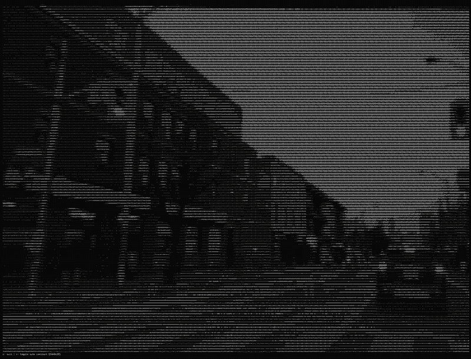

# C-Ascii_cam

Turn your terminal into a live ASCII art using your webcam. Written in C for windows with no third-party libraries.

## Features

- Live webcam feed rendered as ASCII characters
- Keeps the pictures proportions (correcting for tall character cells)
- Automatic contrast
- Keyboard controls to toggle features

## How it works

**Capture.** Windows Media Foundation delivers frames in the NV12 format. The first plane of NV12 is brightness, so it is used directly as a grayscale image.

**Contrast.** A histogram of the frame finds the brightness range, it ignores the darkest and brightest 1% of pixels, and stretches it to the full range.

**Scale.** The frame is sampled down to the terminals grid of characters.

**Render.** Each brightness value picks a character from the ramp `" .:-=+*#%@"`. The whole frame is written to the terminal in one call using ANSI escape codes to redraw in place.

## Build and run

Requirements: Windows 10 or 11, the Visual Studio C++ build tools, and a webcam.

    .\build.bat
    .\build\ascii_cam.exe

Tip: shrink the terminal font (ctrl and minus) for a more detailed picture.

## Controls

| Key | Action |
|---|---|
| `c` | Toggle automatic contrast |
| `q` | Quit |

## License

This project is open source and available under the [MIT License](LICENSE).